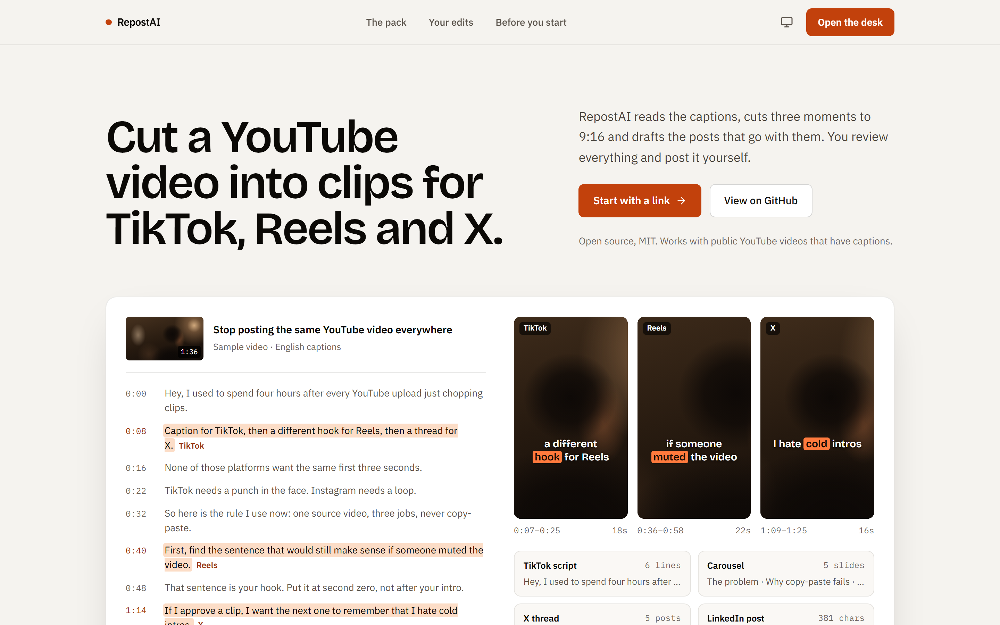
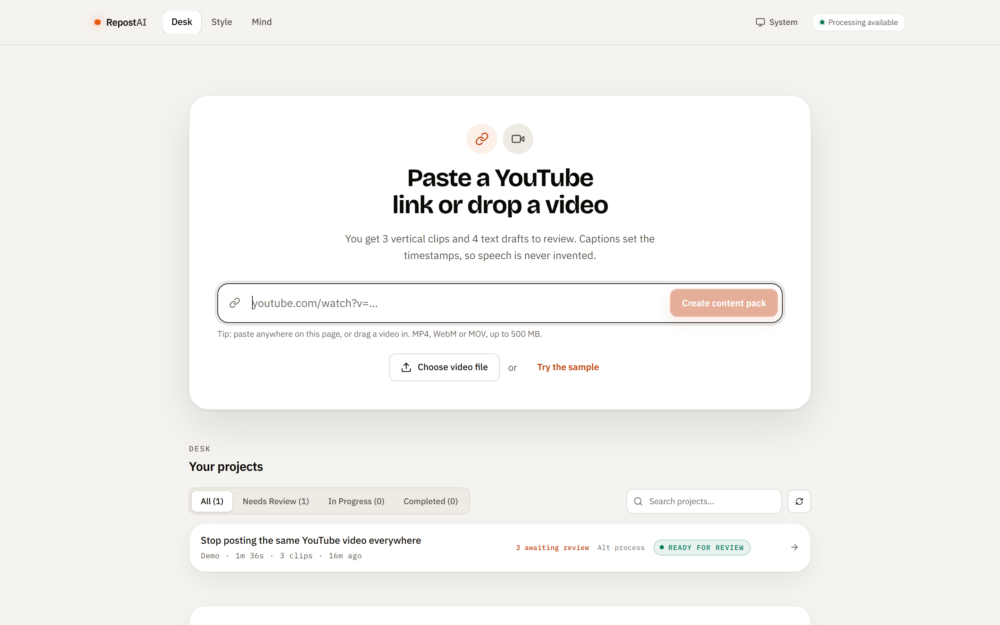
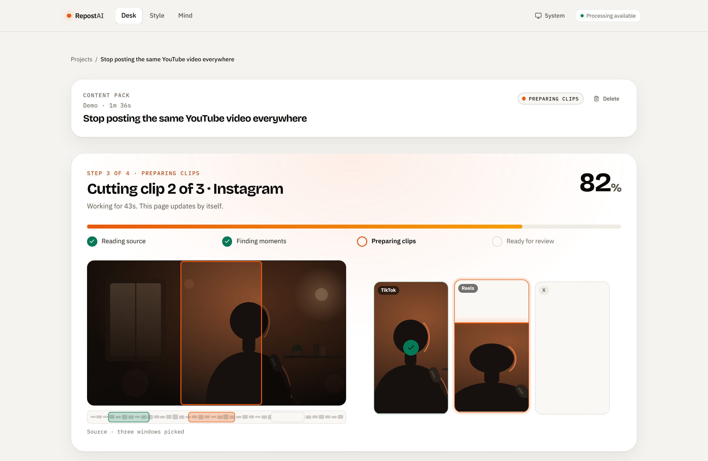
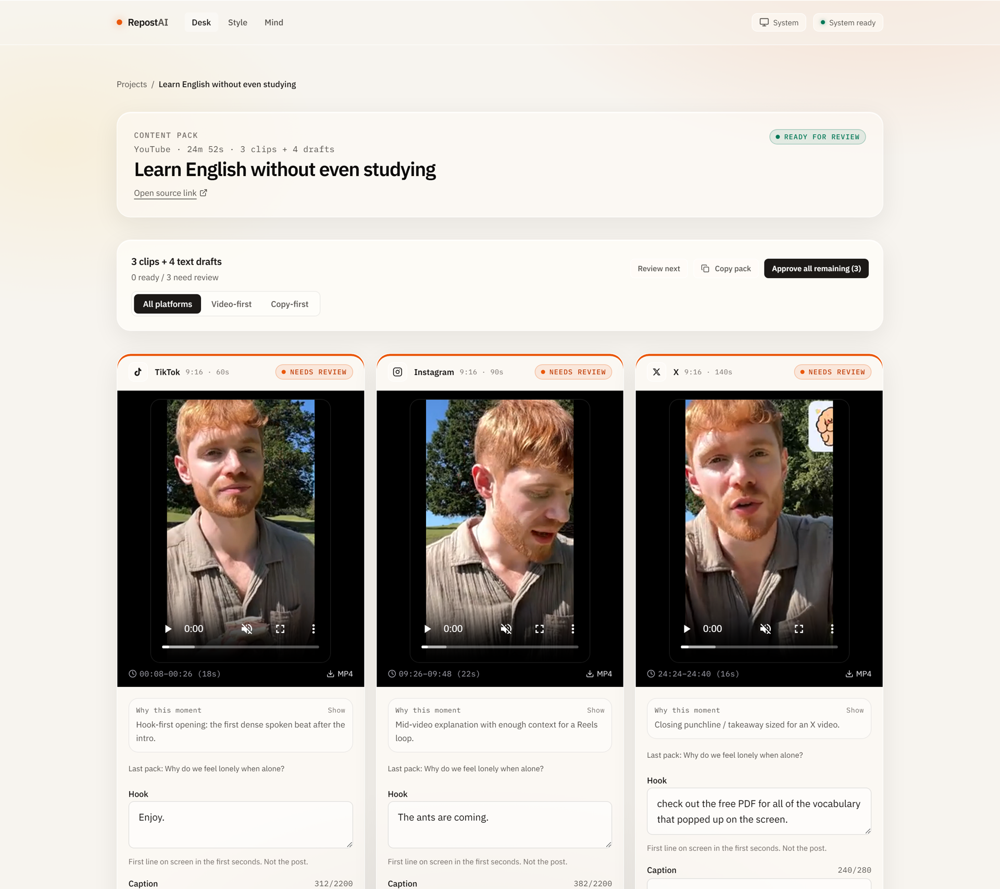
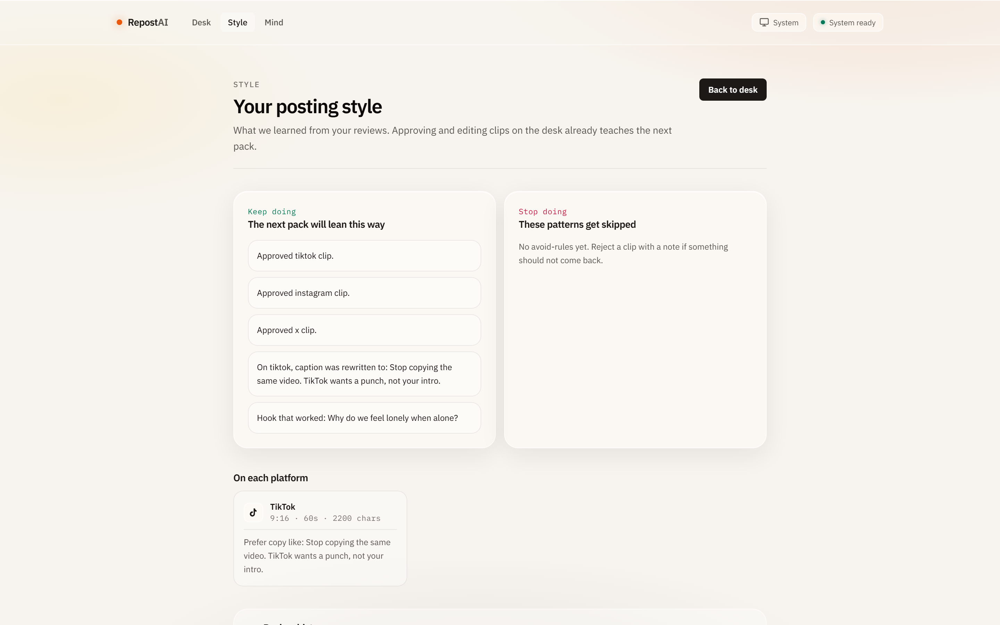
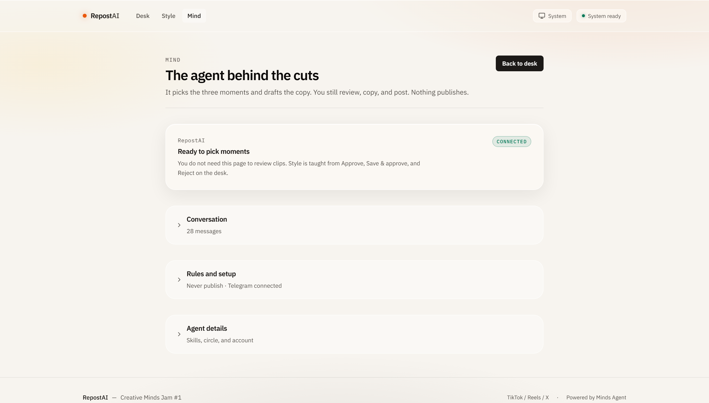

# RepostAI

**One source. Three vertical cuts. Four text drafts. You review. Nothing publishes.**

RepostAI turns a YouTube video into a **content pack**: TikTok, Reels, and X clips plus a script, carousel, thread, and LinkedIn draft. A persistent [Minds](https://hellominds.ai) agent picks the moments. You approve, rewrite, or skip. Those decisions steer the next pack.

**Live app:** [repostai-nine.vercel.app](https://repostai-nine.vercel.app) · **Tested on every pull request** by [TestSprite](https://www.testsprite.com). See [How it's tested](#how-its-tested).

Built for [Creative Minds Jam #1](https://creativemindsjam.com/), track **Content Repurposing Across Platforms**. Extended for [TestSprite Hackathon Season 4](https://www.testsprite.com/hackathon-s4).

> Built with [Minds by Animoca Brands](https://hellominds.ai).

<p align="center">
  
</p>

## Links

| What | Link |
|---|---|
| Live app | [repostai-nine.vercel.app](https://repostai-nine.vercel.app) (no sign-up: open the desk and click **Run the sample**) |
| PR with the TestSprite check | [#6: a planted bug, the gate, and the fix](https://github.com/bagusardin25/RepostAI/pull/6) |
| TestSprite runs on #6 | [Run 1: 30/32, blocked](https://www.testsprite.com/dashboard-v3/o/47417264-6ae1-5d5c-a8bc-37e828bd052e/projects/0aa88bf2-b030-4578-a6f3-3963a511e7be/execution/610c5981-e13c-4561-b100-e3e533a8e86c) · [Run 2: 31/32, blocked](https://www.testsprite.com/dashboard-v3/o/47417264-6ae1-5d5c-a8bc-37e828bd052e/projects/0aa88bf2-b030-4578-a6f3-3963a511e7be/execution/feb64fe0-42bc-415f-8d2a-b67ae371eea7) |
| Earlier loops | [#4: packs that stole each other's agent replies](https://github.com/bagusardin25/RepostAI/pull/4) · [#5: the redesign](https://github.com/bagusardin25/RepostAI/pull/5) |

---

## What you walk away with

Paste a public YouTube link (captions required). Review in minutes, not the afternoon recut.

| Output | What it is |
|---|---|
| 3 vertical clips | 9:16 cuts for TikTok, Instagram Reels, and X, each with the lines spoken in it and a `.srt` subtitle file |
| 4 text drafts | TikTok script, IG carousel, X thread, LinkedIn post |
| Your call | Approve, Save & approve, or Reject (or **A** / **R** on the keyboard), then **Copy pack** |

Nothing posts. MP4s and `.srt` files download one at a time.

---

## How a creator uses it

```
Pick a source  →  Wait  →  Review what is left  →  Take the pack
```

1. **Start** on `/desk` — paste a YouTube link, drop a video file plus its YouTube link for captions, or **Run the sample**.
2. **Wait** — getting the video, picking moments, cutting clips. The page updates by itself.
3. **Review** — sticky bar shows `ready / need review`. Edited clips count as **Ready**. Each clip plays in a phone-shaped 9:16 frame with its hook on screen, and **Safe zones** shades where TikTok, Reels, or X draws its own buttons and text. On a selected clip, **J** / **K** move, **A** approves, **R** rejects, **C** copies the post.
4. **Take** — **Copy pack** copies ready clips (hook, caption, tags, and the timed transcript) plus all four drafts. Download each MP4 and its `.srt` separately.

Optional: **Style** (`/voice`) is keep/stop rules from those reviews. **Mind** (`/mind`) is the agent status. You do not need either page to finish a pack.

**Start** on the desk — one box takes everything. Paste a YouTube link (anywhere on the page works) to see its title and thumbnail, drag a video in and the box grows into a drop zone, or run the sample.

<p align="center">
  
</p>

**Watch** it work — the bar follows the backend's real stage, download size and clip count, and the three 9:16 frames fill in as each cut finishes.

<p align="center">
  
</p>

**Review** the pack — three 9:16 clips, hooks, captions, and Copy pack. Nothing publishes.

<p align="center">
  
</p>

---

## Why the Mind matters

Fallback recipes exist if the agent is offline. The pack then says **Alternative processing** and explains how its clips were picked, never Mind. On the happy path the Mind is the product: one conversation, memory, and a follow-up after every ready pack.

### Prove persistence (pack 1 → pack 2)

1. Open [`/desk`](http://localhost:3000/desk), click **Run the sample** or paste a **public YouTube URL with captions**.
2. Reject one clip with a note (for example `skip cold intros`) and/or save a shorter caption.
3. Open **Style** — keep/stop rules. Open **Mind** → Conversation if you want the transcript.
4. Run a second pack.
5. Compare (`/jobs/compare?a=<first>&b=<second>`) for hook / caption / window diffs.

Tenets live in every propose prompt. Mirror them in the Mind's **Soul** at [hellominds.ai/profile](https://hellominds.ai/profile). On `/mind`, open **Rules and setup** to copy or send them. Link Telegram on the same profile if you want native chat with the same memory.

### Voice loop

```
Pack N: Mind proposes clips
        │
        ▼
You reject TikTok: "skip cold intros"
You rewrite an Instagram caption shorter
You approve X
        │
        ▼
Next pack injects those notes before the Mind proposes again
```

<p align="center">
  
</p>

<p align="center">
  
</p>

### Tenets

- **NEVER publish** — only propose packs for human review
- **NEVER change** the creator's core claim — adapt format and tone only
- **Prefer hook-first clips** — skip long intros unless you like them
- **Ground every timestamp** in the transcript — do not invent speech
- **Respect platform limits** — TikTok/IG ≤ 2200 chars, X ≤ 280 chars

---

## How it's tested

Every pull request is tested end to end by [TestSprite](https://www.testsprite.com) on its own Vercel preview, and `main` only takes a pull request whose TestSprite check passed.

```
Write a change  →  open a PR  →  Vercel builds a preview  →  TestSprite runs the suite on it
      ↑                                                                   │
      └────────  fix the root cause  ←  read the failure on the PR  ←─────┘
```

- **Trigger:** the TestSprite GitHub App fires on the Vercel **Preview** deployment of each PR and tests `https://repostai-git-{branch-slug}-bagusardinp-3679s-projects.vercel.app`. Previews call the production API, so a run exercises the real pipeline, the Mind included.
- **Results:** a TestSprite comment on the PR (per-test video, steps, error, cause, and fix) and a `TestSprite V3` commit status.
- **CI:** GitHub Actions runs `pnpm lint`, `pnpm test`, and `pnpm build` on every pull request ([`.github/workflows/ci.yml`](.github/workflows/ci.yml)).
- **Merge gate:** a ruleset on `main` requires a pull request, a passing `TestSprite V3` status, and a passing CI job, with no bypass. TestSprite reports failures as a failing status, so a failed test holds the merge.

### Bugs the loop caught, in short

| Bug | Found in | Commit |
|---|---|---|
| Packs stole each other's AI replies, so fresh packs fell back to the non-AI picker | TestSprite runs on PR #2 and #3 | `0b90521` |
| The API process died mid-run on an uncatchable `fetch` assertion, and 26 packs in progress failed | TestSprite, PR #4 run 1 | `b30c0c4` |
| The Nth pack waited about N × 3 minutes for the Mind | TestSprite runs on PR #4 and #5 | `4518e5c` |
| ffmpeg ran out of threads when several packs were cut at once | TestSprite run on PR #2 | `d9df30e` |
| The review API saved an X caption over 280 characters | PR #6, while checking a false pass | `da9e32d` |

Each fix is its own commit, and its message names the test that found it. The sections below have the runs and the smaller catches.

### Test runs stay out of production data

Previews call the production API, so the first runs left about a hundred demo packs on the live desk and taught the saved style from test reviews. Now a pack started from a pull request preview (origin `<project>-git-<branch>-*.vercel.app`, any branch but `main`) is marked **sandbox**:

- The live desk, the Style page, and the style used for real packs leave sandbox packs and their reviews out. Previews still see them, so the suite runs unchanged.
- Reviews and follow-ups on sandbox packs are not sent to the Mind, so test runs do not teach it.
- The pack page and the desk mark them **Preview test pack**.
- Test packs from before this change were marked with a one-time, reversible script ([`backend/scripts/mark-sandbox.mjs`](backend/scripts/mark-sandbox.mjs): a dry run by default, `--apply`, and `--undo`). Nothing was deleted.

### What the suite covers

32 frontend UI cases built in the TestSprite 3.0 web portal, in the project *RepostAI PR gate*, with no sign-in. Every pull request runs all of them on its own preview.

| Area | Cases | What they check |
|---|---|---|
| Landing and navigation | 5 | Landing → desk, header navigation, a theme toggle that persists, the system status dialog, Style → back to the desk |
| Starting a pack and errors | 4 | The demo sample, a non-YouTube link is refused with a message, a failed pack shows its error and Retry, an unknown pack id shows "Job not found" |
| Review | 5 | Approve, edit the hook and Save & approve, reject with a note, Approve all remaining, an X caption over 280 characters cannot be approved |
| Pack workspace | 4 | A finished pack's clips and drafts, view presets, the source transcript and its search, Why these moments |
| Taking the pack | 4 | Copy one post, Copy pack, the four text drafts, the three MP4 download links |
| Desk | 4 | Open a pack, search, list filters, delete a project |
| Learning loop | 6 | Compare two packs, the learned style rules and their details, the Mind's status, its conversation, and its saved rules |

Cases that change a pack start their own from the demo sample. Cases that only read open a pack from the **Reviewed** tab, which no case changes.

`pnpm test` adds unit tests for the pipeline (Mind queue and time limits, transcript grounding, voice memory, ffmpeg, YouTube limits, interrupted packs), media downloads, the crash guard, sandbox detection and filtering, the backfill script, the caption limit, and frontend helpers (download links, Copy pack, clip transcripts and `.srt`, safe zones, the caption limit on review).

### What the loop caught: PR #2 and #3

The first runs, 59 cases on [PR #2](https://github.com/bagusardin25/RepostAI/pull/2) and [PR #3](https://github.com/bagusardin25/RepostAI/pull/3), found these problems. They also found the Mind reply race that PR #4 fixes.

| Found in | What the tests saw | Root cause | Commit |
|---|---|---|---|
| PR #2 | Sample packs ended in Failed with "pthread_create failed: Resource temporarily unavailable" when several were cut at once | Every pack ran ffmpeg with no limit on processes or threads | `d9df30e` |
| PR #2 | The Completed filter listed finished packs, but every row still read "Ready for review" | No label for a pack with nothing left to review | `7e12986` |

### What the loop caught: PR #4

[PR #4](https://github.com/bagusardin25/RepostAI/pull/4) went through the loop. The same 91 TestSprite cases ran before and after its fixes:

| Run | Commit | Passed | Failed | Blocked |
|---|---|---|---|---|
| [PR #4, run 2](https://www.testsprite.com/dashboard-v3/o/47417264-6ae1-5d5c-a8bc-37e828bd052e/projects/734e4b92-5ac8-432c-9270-df86c2c3cc32/execution/8689bf2c-2273-4799-8c5f-f2f37c36e666) | `22ae6fb` | 56 | 15 | 20 |
| [PR #5](https://www.testsprite.com/dashboard-v3/o/47417264-6ae1-5d5c-a8bc-37e828bd052e/projects/734e4b92-5ac8-432c-9270-df86c2c3cc32/execution/eb4b890e-d4d7-44b6-a50d-e751de71846e) | `c3d2f12` | 64 | 17 | 10 |
| [PR #4, run 3](https://www.testsprite.com/dashboard-v3/o/47417264-6ae1-5d5c-a8bc-37e828bd052e/projects/734e4b92-5ac8-432c-9270-df86c2c3cc32/execution/9c7268ec-939b-4872-b7b5-c8382819a1cd) | `c8d0baa` | 83 | 3 | 5 |

Each fix is its own commit, and its message says what TestSprite found:

| What the tests saw | Root cause | Commit |
|---|---|---|
| Fresh packs sat on "Finding moments", then fell back | Packs started together shared one Mind conversation and took each other's replies | `0b90521` |
| Packs failed mid-run; the page showed "Failed to fetch" | An uncatchable fetch socket assertion ended the API; the page stopped polling after one error | `b30c0c4`, `22ae6fb` |
| Demo packs sat on "Preparing clips" | Every demo pack cut the same windows again | `0b61b33` |
| Packs sat on "Choosing three moments" past five minutes | A pack had no limit on its time in the Mind queue, so the Nth pack waited about N × 3 minutes | `4518e5c` |
| `FOREIGN KEY constraint failed` in the logs | A pack deleted mid-run still inserted its clips | `6eb1bd1` |
| No copied state, no word on how moments were picked, no status on the landing page | UI gaps | `09212ca`, `415afcc`, `c8d0baa` |

### What the loop caught: PR #5

[PR #5](https://github.com/bagusardin25/RepostAI/pull/5) carries the redesign. Its runs, and the last run on #4, found these problems. Each fix is its own commit:

| Found in | What the tests saw | Root cause | Commit |
|---|---|---|---|
| [PR #4, run 3](https://www.testsprite.com/dashboard-v3/o/47417264-6ae1-5d5c-a8bc-37e828bd052e/projects/734e4b92-5ac8-432c-9270-df86c2c3cc32/execution/9c7268ec-939b-4872-b7b5-c8382819a1cd) | An MP4 link played the clip instead of saving it | The media route sent no `Content-Disposition`, so the browser opened the video | `73317a8` |
| [PR #4, run 3](https://www.testsprite.com/dashboard-v3/o/47417264-6ae1-5d5c-a8bc-37e828bd052e/projects/734e4b92-5ac8-432c-9270-df86c2c3cc32/execution/9c7268ec-939b-4872-b7b5-c8382819a1cd) | "Copied 4 drafts. 3 still need review." read as if the clips had been dropped | The message did not say that clips wait for approval | `73317a8` |
| [PR #5, run 1](https://www.testsprite.com/dashboard-v3/o/47417264-6ae1-5d5c-a8bc-37e828bd052e/projects/734e4b92-5ac8-432c-9270-df86c2c3cc32/execution/6cbef7c9-2c53-4cdf-9082-76f4a2e952b0) | Enter on a non-YouTube link did nothing, with no "Invalid YouTube URL" | A disabled submit button also blocks Enter, and the hint waited for the field to lose focus | `788682c` |
| [PR #5, run 1](https://www.testsprite.com/dashboard-v3/o/47417264-6ae1-5d5c-a8bc-37e828bd052e/projects/734e4b92-5ac8-432c-9270-df86c2c3cc32/execution/6cbef7c9-2c53-4cdf-9082-76f4a2e952b0) | A search with no matches said "Nothing in this tab." | The empty state did not tell a search apart from an empty tab | `788682c` |
| [PR #5, run 2](https://www.testsprite.com/dashboard-v3/o/47417264-6ae1-5d5c-a8bc-37e828bd052e/projects/734e4b92-5ac8-432c-9270-df86c2c3cc32/execution/51e1ad2d-72b5-4de8-9d06-698449a456da) | A finished pack had no "Download MP4s" section | Merging #4 into the redesign renamed the section "Downloads" | `4f592e9` |
| [PR #5, run 3](https://www.testsprite.com/dashboard-v3/o/47417264-6ae1-5d5c-a8bc-37e828bd052e/projects/734e4b92-5ac8-432c-9270-df86c2c3cc32/execution/03509d9a-b03f-4d55-89f5-ffbdc3a63d53) | Approved clips read "Approved" while the review bar counted them as ready | The redesign renamed the live app's "Ready" label | `d690215` |
| [PR #5, run 3](https://www.testsprite.com/dashboard-v3/o/47417264-6ae1-5d5c-a8bc-37e828bd052e/projects/734e4b92-5ac8-432c-9270-df86c2c3cc32/execution/03509d9a-b03f-4d55-89f5-ffbdc3a63d53) | The status dialog said "Projects" instead of "Saved projects" | The redesign renamed the live app's label | `d690215` |
| [PR #5, run 3](https://www.testsprite.com/dashboard-v3/o/47417264-6ae1-5d5c-a8bc-37e828bd052e/projects/734e4b92-5ac8-432c-9270-df86c2c3cc32/execution/03509d9a-b03f-4d55-89f5-ffbdc3a63d53) | "Cut this video" stayed disabled for a non-YouTube link, so clicking it did nothing | The button was enabled only for a YouTube link, so a click never reached the check that explains why | `d690215` |

Run 2 confirmed the run 1 fixes: both copies of "Reject an invalid YouTube link" and "Search projects in the Desk list" passed. Run 3 confirmed the run 2 fix: both copies of "Review a finished pack workspace" passed. The other failures in these runs came from older cases written for the pre-redesign UI (the Upload video and Try sample tabs, a "CONTENT PACK" label, Copy pack including clips still under review) or from the shared preview data, such as deleting one of a hundred sample packs with the same title.

PR #5 was merged with a one-time admin bypass, because its trigger replayed an old list of 91 test IDs, including cases deleted from the plan. Since PR #6, pull requests run on a TestSprite project whose plan holds only the 32 current cases, and the ruleset has no bypass.

### What the loop caught: PR #6

[PR #6](https://github.com/bagusardin25/RepostAI/pull/6) tested the gate itself. Its first commit planted a regression on purpose: Approve skipped the caption limit, so a 300-character X caption was saved and the clip turned Ready. Unit tests and the build still passed.

- **The gate held.** The first run went red, 30 of 32, and the required check blocked the merge.
- **The two failures were test wording, not the app.** One case read the small MP4 links inside the clip cards instead of the "Download MP4s" list. The other searched the transcript for "the" and misread lines that contain it. Both cases were rewritten.
- **The case written for the planted bug passed by mistake.** Its generated script filled the caption but never clicked Save & approve, and the run's AI judge passed it. No caption over 280 characters was saved by any run, which we checked against the API. The case now has to make the click and see the over-limit message. The same had happened on PR #4, where a delete case passed with no delete click in its run log.
- **The real gap was on the server.** The review API accepted a 300-character X caption with HTTP 200, so the limit lived only in one branch of the clip card's handler.

The fix checks the limit for every action but Reject, in the card ([`frontend/lib/caption-limit.ts`](frontend/lib/caption-limit.ts)) and in the API, which now answers `422` for an over-limit caption. Unit tests cover both, so CI catches this without the browser suite. The PR could merge only after TestSprite passed on the fix. Run links are on the PR.

---

## Architecture

```
pnpm dev
```

Starts two processes:

```
┌──────────────────────┐          ┌──────────────────────┐
│   Next.js Frontend   │  /api/*  │   Node.js Backend    │
│      :3000           │ ──────── │      :4000           │
│                      │  rewrite │                      │
│  Landing (/)         │          │  HTTP handlers       │
│  Desk (/desk)        │          │  Pipeline:           │
│  Content pack        │          │   YouTube → Mind →   │
│  Style / Mind        │          │   ffmpeg → clips     │
└──────────────────────┘          └──────────────────────┘
                                          │
                                          ▼
                                  ┌──────────────────┐
                                  │  Minds Platform  │
                                  │  Memory ◄── reviews
                                  └──────────────────┘
```

```
Source ──► captions / transcript
              │
              ▼
        Minds Agent  ◄── style from prior reviews
        (local fallback if the Mind is offline)
              │
              ▼
        ffmpeg cuts 9:16 files
              │
              ▼
        Ready for review → Copy pack / download MP4s
```

---

## Getting started

### Prerequisites

- Node.js 22+
- pnpm

### Install

```bash
git clone https://github.com/bagusardin25/RepostAI.git
cd RepostAI
pnpm install
```

### Configure

Copy `.env.example` to `.env.local` at the project root:

```env
FRONTEND_PORT=3000
BACKEND_PORT=4000

MINDS_BUILDER_API_KEY=your_key_here
MINDS_MIND_ID=your_mind_id
MINDS_CONVERSATION_ALIAS=main
```

Get a key from the [Minds Builder Console](https://build.hellominds.ai/console).

Without a Minds key the cutter still runs on the demo sample, but jobs are labeled **Alt process**. The real loop needs a Builder key and Mind id.

### Run

```bash
pnpm dev
```

| URL | What |
|---|---|
| [http://localhost:3000](http://localhost:3000) | Landing |
| [http://localhost:3000/desk](http://localhost:3000/desk) | Start a content pack |
| [http://localhost:3000/jobs/…](http://localhost:3000/desk) | Review and copy |
| [http://localhost:3000/voice](http://localhost:3000/voice) | Style (keep / stop) |
| [http://localhost:3000/mind](http://localhost:3000/mind) | Mind status |
| [http://localhost:3000/jobs/compare](http://localhost:3000/jobs/compare) | Compare two packs |

YouTube jobs need **captions**. Upload-only has no speech-to-text, so after you drop a file the desk asks for that video's captioned YouTube link.

### Demo sample

On the desk, click **Run the sample**. It runs one built-in demo source: *Stop posting the same YouTube video everywhere*. It skips YouTube download, uses the built-in transcript, and writes local 9:16 files.

### Other commands

| Command | Description |
|---|---|
| `pnpm test` | Backend unit tests (`node:test`) and frontend helper tests (`tsx`) |
| `pnpm lint` | TypeScript check |
| `pnpm build` | Production build |
| `pnpm start` | Production frontend |

---

## Pages

### Landing (`/`)

One source → 3 clips + 4 drafts. You stay the publisher.

### Desk (`/desk`)

YouTube link, an uploaded video plus its YouTube link (for the captions), or the demo sample. **Projects** lists packs, with To review, Running and Reviewed tabs. Channel watch sits in a collapsed **Watch a channel** row.

### Content pack (`/jobs/[id]`)

Sticky review bar (`ready / need review`, Review next, Approve all remaining, Copy pack) with keyboard review: **J** / **K** move, **A** approves, **R** rejects, **C** copies the post. View presets: All platforms, Video-first, Copy-first (display only — all three clips are still produced). Each clip card has a phone-shaped 9:16 preview with the hook on screen for its first 3 seconds, a **Safe zones** overlay for the platform's own UI, the clip's transcript with **Copy transcript** and **Download .srt**, and an MP4 download. **Why these moments** says whether the Mind or alternative processing picked them; the source transcript sits below.

Edited and approved clips are **Ready**. Needs-review clips are not copied without a warning.

### Compare (`/jobs/compare`)

Earlier pack left, later pack right. Hook / caption / window diffs.

### Style (`/voice`)

Keep doing / stop doing from desk reviews. History, score, and JSON export are behind details.

### Mind (`/mind`)

Connected / offline card. Conversation, rules, Telegram, and skills are behind details.

---

## API

Backend on `:4000`. The frontend proxies `/api/*`.

| Method | Path | Description |
|---|---|---|
| `GET` | `/api/health` | db, ffmpeg, minds |
| `GET` | `/api/jobs` | List packs with clip counts |
| `POST` | `/api/jobs` | Create (JSON or multipart with video) |
| `GET` | `/api/jobs/:id` | Detail, clips, drafts, lineage |
| `GET` | `/api/jobs/compare?a=&b=` | Side-by-side |
| `POST` | `/api/jobs/:id` | Retry a failed pack |
| `POST` | `/api/clips/:id/review` | `{ action, caption?, hook?, note? }` |
| `GET` | `/api/voice` | Style memory + review history |
| `GET` | `/api/mind` | Mind profile, circle, skills |
| `GET` | `/api/mind/history` | Conversation transcript |
| `POST` | `/api/mind/tenets` | Seed standing rules |
| `GET` | `/api/watch` | Channel watch config |
| `GET` | `/api/media/:kind/:file` | Source / clip MP4s (supports Range) |

### Create a pack

```bash
curl -X POST http://localhost:4000/api/jobs \
  -H "Content-Type: application/json" \
  -d '{"youtubeUrl": "https://www.youtube.com/watch?v=..."}'

curl -X POST http://localhost:4000/api/jobs \
  -H "Content-Type: application/json" \
  -d '{"fixture": true}'
```

`202` with `{ job }`. Work continues in the background.

Status: `queued → fetching_source → analyzing → clipping → ready | failed`

### Review a clip

```bash
curl -X POST http://localhost:4000/api/clips/{id}/review \
  -H "Content-Type: application/json" \
  -d '{"action": "edit", "caption": "New caption", "hook": "New hook", "note": "shorter please"}'
```

Actions: `approve`, `reject`, `edit`. Each review is stored and sent to the Mind for the next pack.

---

## Tech stack

| Layer | Technology |
|---|---|
| Frontend | Next.js 15 (App Router), TypeScript, Tailwind CSS v4 |
| Backend | Node.js (`http.createServer`), JavaScript |
| Agent | [Minds](https://hellominds.ai) via `@animocabrands/minds-client-lib` |
| Database | SQLite via `@libsql/client` (file locally, Railway volume in production) |
| Video | `ffmpeg-static` (9:16) |
| YouTube | `youtubei.js` (meta, captions, download) |
| Package manager | pnpm |

---

## Repository

```
RepostAI/
├── backend/               # API (:4000)
│   ├── server.js
│   ├── http/              # Route handlers
│   ├── pipeline/          # YouTube, Minds, ffmpeg, recipes, voice
│   ├── db/                # SQLite
│   └── lib/
├── frontend/              # UI (:3000)
│   ├── app/               # /, /desk, /jobs/[id], /jobs/compare, /voice, /mind
│   ├── components/
│   ├── lib/               # API client, content-pack copy helpers
│   └── styles/
├── docs/screenshots/      # Product shots in this README
├── data/                  # Runtime (gitignored)
├── .env.example
├── package.json
└── LICENSE
```

---

## Platform limits

| Platform | Max duration | Aspect | Caption |
|---|---|---|---|
| TikTok | 60s | 9:16 | 2200 chars |
| Instagram | 90s | 9:16 | 2200 chars |
| X | 140s | 9:16 | 280 chars |

---

## Production deploy (Vercel + Railway)

Frontend on **Vercel**. Backend (ffmpeg, YouTube, SQLite, MP4s) on **Railway**. That split is required: Vercel is serverless and cannot run the cutter.

### Do we need PostgreSQL?

**No.** Keep SQLite. This API is one process that writes local MP4s; Postgres would not store those files and would not let you run multiple replicas anyway. Production needs a **Railway volume** at `/data` so `repostai.db`, sources, and clips survive deploys.

Do not set `DATABASE_URL` to a Postgres URL — the client is `@libsql/client`.

### 1. Railway (API)

1. Create a project and deploy this repo (Dockerfile + `railway.toml`).
2. Attach a **volume** mounted at `/data`.
3. Generate a public domain.
4. Set variables:

```env
FRONTEND_ORIGIN=https://your-app.vercel.app
MINDS_BUILDER_API_KEY=...
MINDS_MIND_ID=...
MINDS_CONVERSATION_ALIAS=main
```

`PORT` and `RAILWAY_VOLUME_MOUNT_PATH` are injected. Keep **one replica**.

Health check: `GET /api/health`.

### 2. Vercel (UI)

Import the GitHub repo.

| Setting | Value |
|---|---|
| Framework | Next.js |
| Install | `pnpm install` |
| Build | `pnpm build` (`next build frontend`) |
| Root Directory | repository root (leave default) |

Environment variables (use the Railway domain from step 1):

```env
NEXT_PUBLIC_BACKEND_ORIGIN=https://your-api.up.railway.app
BACKEND_ORIGIN=https://your-api.up.railway.app
```

JSON and uploads go to Railway (avoids Vercel body limits). Relative `/api/media/...` URLs still rewrite through Vercel for same-origin playback.

After the Vercel URL exists, set `FRONTEND_ORIGIN` on Railway to that URL and redeploy the API if needed.

### 3. Order

Railway first (domain) → Vercel env + deploy → put the Vercel origin on Railway CORS → confirm `/api/health` from the live UI.

## License

[MIT](LICENSE)
